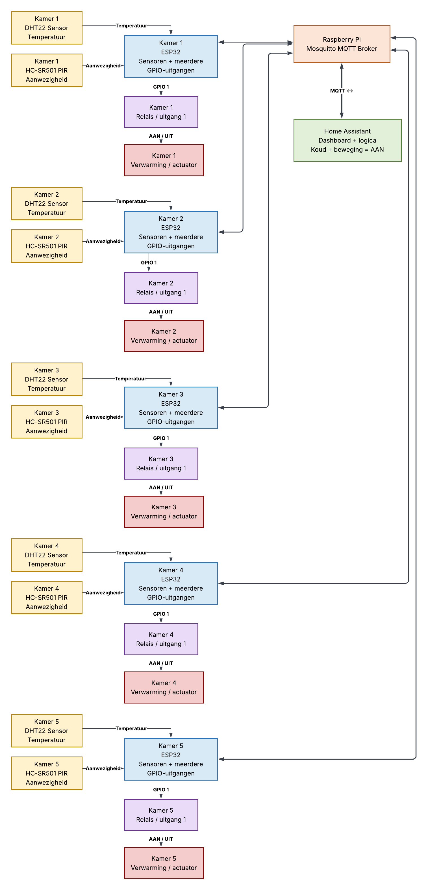

# Hardware

Deze pagina beschrijft de hardware van de slimme klimaatregeling per ruimte. De componentenlijst is gebaseerd op de projectbeschrijving en de huidige ESP32-firmware. Waar gegevens of aansluitingen nog niet zijn vastgelegd, staat dat erbij in plaats van ze te veronderstellen.

## Overzicht

Het systeem meet de temperatuur en beweging in een kamer met een ESP32, DHT22 en HC-SR501. De ESP32 verstuurt de meetgegevens via wifi en MQTT naar Home Assistant op een Raspberry Pi 4. Een 5V-relaismodule is voorzien om de verwarming te schakelen; de aansturing daarvan is nog niet aanwezig in de huidige firmware.

> Dit is een blokschema, geen elektrisch bedradingsschema. De exacte bedrading en voedingsaansluitingen moeten nog worden vastgelegd.

## Componentenlijst

| Component | Type/model | Functie | Aantal | Datasheet / status |
|---|---|---|---:|---|
| Edge device | ESP32 Development Board (ESP32-WROOM-32E) | Leest sensoren uit en communiceert via wifi en MQTT | 1 | Exact boardmodel en bijbehorende datasheet nog vastleggen |
| Temperatuursensor | DHT22 | Meet de kamertemperatuur | 1 | Datasheet nog toevoegen aan [`docs/datasheets/`](../docs/datasheets/) |
| Aanwezigheidssensor | HC-SR501 PIR | Detecteert beweging als indicatie van aanwezigheid | 1 | Datasheet nog toevoegen aan [`docs/datasheets/`](../docs/datasheets/) |
| Actuator | 1-kanaals 5V-relaismodule | Schakelt de verwarmingsregeling | 1 | Exact model en datasheet nog vastleggen; aansluiting/firmware nog niet gedocumenteerd |
| Centrale server | Raspberry Pi 4 | Draait Home Assistant en de Mosquitto MQTT-broker | 1 | Voedingsspecificatie afhankelijk van de gebruikte uitvoering en voeding |

## Aansluitingen en communicatie

De firmware legt deze ESP32-aansluitingen vast:

| Signaal | ESP32-aansluiting | Opmerking |
|---|---|---|
| DHT22 DATA | GPIO 4 | Temperatuurmeting |
| HC-SR501 OUT | GPIO 5 | Bewegingsdetectie |
| Relaissignaal | Nog niet vastgelegd | Relaisaansturing ontbreekt nog in de firmware |

- **Communicatie:** wifi en MQTT; de huidige firmware gebruikt MQTT-poort `1883`.
- **MQTT-topics:** `kamer1/temperatuur` en `kamer1/beweging`.
- **ESP32-logicaniveau:** 3,3 V. Controleer vóór aansluiting of sensoren en de relaismodule hiermee elektrisch compatibel zijn; sluit een 5V-signaal niet rechtstreeks aan op een ESP32-GPIO.
- **Voedingsspanning en stroomverbruik:** nog te bepalen op basis van de gekozen board-, sensor- en relaisuitvoering. Documenteer deze waarden na controle van de datasheets en de werkelijke opstelling.

## Schema's en bestanden

- [Blokschema (PNG)](../docs/images/blokschema.png)
- [Blokschema (PDF)](../docs/images/blokschema%20IoT.pdf)
- Een elektrisch aansluitschema is nog niet beschikbaar. Voeg dit toe aan `docs/images/` en werk deze README bij zodra het schema is gecontroleerd.
- Datasheets horen in [`docs/datasheets/`](../docs/datasheets/). Controleer de bestandsnamen en inhoud voordat je ze aan een component koppelt.

## Veiligheid en aandachtspunten

- Test de software eerst met een veilige laagspanningsbelasting.
- Een relais dat netspanning of een verwarmingsinstallatie schakelt, moet correct gedimensioneerd en veilig geïsoleerd zijn. Laat de netspanningsaansluiting uitvoeren of controleren door iemand met de juiste kennis.
- Leg de exacte relaistype, aansluitingen, voedingsvereisten en veilige schakelbelasting vast voordat de verwarming wordt aangesloten.
- De huidige firmware leest de DHT22 en PIR uit, maar stuurt het relais nog niet aan.

## Checklist

- [ ] Exacte componentmodellen en bijbehorende datasheets gecontroleerd
- [ ] Elektrisch aansluitschema toegevoegd en gecontroleerd
- [ ] Voedingsspanningen en stroomverbruik gemeten of uit datasheets bepaald
- [ ] Compatibiliteit van de relaismodule met de 3,3V-ESP32-GPIO gecontroleerd
- [ ] Relaisschakeling veilig getest met een laagspanningsbelasting
- [ ] Firmware bijgewerkt en getest als de relaisaansturing wordt toegevoegd
